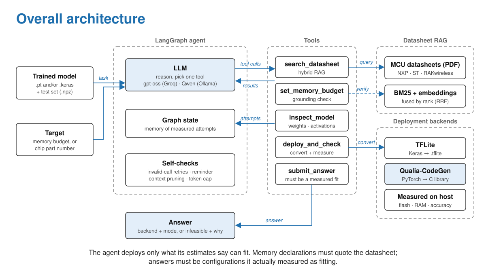

# Edge Deploy Agent

An LLM agent that figures out **how to deploy a neural network on a microcontroller**. Given a trained model and a target, either a memory budget or just a real chip's part number, it reads the datasheet, inspects the model, quantizes, measures, and iterates until the model fits the flash, RAM and accuracy constraints, or explains why it cannot.

- **Agent**: [LangGraph](https://github.com/langchain-ai/langgraph) loop with tool calling, memory of measured attempts, context pruning and self-checks.
- **Retrieval**: hybrid search (BM25 + embeddings) over MCU datasheets from NXP, ST and RAKwireless, with grounded memory extraction.
- **Deployment**: two real backends, TFLite and [Qualia-CodeGen](https://github.com/LEAT-EDGE/qualia-codegen-core) (PyTorch → C), with flash, RAM and accuracy measured on the converted model.
- **Evaluation**: 30 scenarios with ground truth, scored against a brute-force baseline, across hosted and local open-weight LLMs.
- **Free to run**: [Groq](https://groq.com)'s free tier or fully local with [Ollama](https://ollama.com).

## Results

Each scenario pairs a model with a target. **Generic** targets give the memory budget; **chip** targets only give a part number, so the agent must find the memory in the datasheet first. A run is correct when the agent's answer is right against the true budget: a configuration that really fits, or "infeasible" when nothing does. The brute-force baseline tries every configuration in a fixed order until one fits.

| LLM | Scenarios | Runs | Correct | Chip memory extracted | Deployments (agent / brute force) | Tokens / run |
|---|---|---|---|---|---|---|
| gpt-oss-120b (Groq) | generic | 4 | 100 % | | 0.8 / 3.2 | 4 k |
| gpt-oss-20b (Groq) | generic | 9 | 100 % | | 0.8 / 3.9 | 4 k |
| gpt-oss-20b (Groq) | chip | 4 | 100 % | 50 % | 1.8 / 1.8 | 28 k |
| qwen2.5:3b (local) | generic | 27 | 74 % | | 1.7 / 3.9 | 17 k |
| qwen2.5:3b (local) | chip | 63 | 8 % | 2 % | 0.2 / 3.8 | 52 k |

What the runs show:

- **With a given budget, the gpt-oss models are right every time with 4 to 5 times fewer deployments than brute force.** They estimate weight and activation sizes first, deploy only what can fit, and conclude "infeasible" without deploying at all when even 8-bit weights exceed the flash.
- **A correct answer can hide a wrong reading of the datasheet.** gpt-oss-20b read the STM32WL33C8 as 256 KB / 32 KB (the "CC" variant) and the LPC55S66 with the LPC55S69's figures, yet picked configurations that also fit the true budgets. Scoring memory extraction separately is what exposes this.
- **Telling apart part numbers that share one datasheet is the hardest case for every model.** In "STM32WL33**C8**", `C` is the pin count and `8` the memory size (64 KB / 16 KB); all models used the `C` row of the ordering table. The quote they give is real, so the grounding check passes: the error is a misattribution, not a hallucination.
- **Model size shows directly in tool use.** The 3B model handles simple choices but cannot fill the 6-field memory declaration correctly, so it rarely gets to deploy on real chips.

`python scripts/evaluate.py` reproduces the runs (resumable across provider quotas), `python scripts/report.py` builds the table.

## How it works



A PNG version for slides is in [`docs/architecture.png`](docs/architecture.png); `python docs/make_architecture.py` regenerates both.

**Agent loop.** The LLM calls one tool at a time and sees its result. Every measured deployment is kept in the graph state and re-injected into the system prompt as a table, and a configuration already measured is served from memory instead of being redeployed. Once the memory declaration is accepted, the datasheet passages are pruned from the context, which keeps later steps small enough for free-tier token caps. Invalid tool calls, malformed arguments and text replies without a tool call are sent back to the model to correct. Generated tokens are capped per call, since small models can loop.

**Datasheet retrieval.** `pdftotext -layout` keeps table rows on one line, pages are cut into overlapping chunks, and BM25 (exact part numbers, units) is fused with local `bge-small-en-v1.5` embeddings (paraphrases such as "on-chip RAM" for SRAM) by reciprocal rank fusion. The agent must decode the part number field by field from the ordering scheme, then declare flash and SRAM with a verbatim quote: the declaration is rejected unless the quote appears in the retrieved passages and contains the declared sizes. The model gets 50 % of the usable on-chip flash and 50 % of the SRAM, or a 4 MB external flash budget when the chip has none.

| Chip | Vendor | What the agent must get right |
|---|---|---|
| MCXN947VDFT | NXP | 2 MB / 512 KB from a 10-part ordering table |
| MIMXRT1062 | NXP | no on-chip flash, 1 MB SRAM |
| LPC55S69JBD100 | NXP | 640 KB flash of which 10 KB reserved |
| LPC55S66JBD100 | NXP | same datasheet as the S69, 256 KB / 144 KB |
| STM32L476RG | ST | the letter G sets the flash size (1 MB) |
| STM32WL33C8 | ST | C = pin count, 8 = memory (64 KB / 16 KB) |
| RAK3172 | RAKwireless | the 512 KB external flash is only on the RAK3172-F |

**Deployment backends.**

| Backend | Input | Output | Modes | Footprint |
|---|---|---|---|---|
| TFLite | Keras | `.tflite`, run by TFLite Micro | `float32`, `float16`, `dynamic_int8`, `full_int8` | flash = file size, RAM from activation buffers |
| Qualia-CodeGen | PyTorch | plain C library, no runtime | `float32`, `int16`, `int8` (power-of-two fixed point) | flash and RAM measured on the compiled code |

The Qualia C code is compiled and run on the host (Qualia's Linux demo) to measure its real accuracy. Its per-layer scale factors follow qualia-core's post-training rules (minmax range, running max of activations over calibration data, one scale factor for weights and biases) plus **accumulator headroom**. qualia-core relies on quantization-aware training; with post-training quantization only, max-precision weights overflow the accumulators:

| Model | int16 without headroom | int16 with | int8 without | int8 with |
|---|---|---|---|---|
| mnist_cnn_small | overflow | 97.8 % | 81.5 % | 97.8 % |
| mnist_cnn_medium | overflow | 98.4 % | 18.5 % | 98.5 % |
| fashion_mlp_large | overflow | 85.8 % | 22.4 % | 86.9 % |

The TFLite RAM estimate for float32 models matches the RAM measured on Qualia's generated buffers (26.4 KB for mnist_cnn_small).

## Bring your own model

Give a name, a `.pt` (full PyTorch model saved with `torch.save(model, path)`, enables Qualia), a `.keras` (enables TFLite) or both, and an `.npz` with `x_test`, `y_test` and optionally `x_calib` (channels last, 1D or 2D inputs). The agent is only offered the backends available for your model.

```bash
python examples/byom/make_example.py     # 1D CNN on synthetic 3-axis sensor windows
python scripts/run_agent.py sensor_cnn STM32L476RG \
    --pt examples/byom/out/sensor_cnn.pt --keras examples/byom/out/sensor_cnn.keras \
    --data examples/byom/out/sensor_data.npz
```

## Quick start

```bash
conda create -n edgeagent python=3.11 -y && conda activate edgeagent
conda install -c conda-forge gcc gxx cmake ninja -y   # to build Qualia's C code
pip install -e ".[dev]"
cp .env.example .env                                  # paste a free key from https://console.groq.com/keys

pytest                                                # 25 tests, no download
python scripts/make_reference_models.py               # 3 reference models, Keras + PyTorch
python scripts/run_agent.py mnist_cnn_small tiny      # generic target
python scripts/run_agent.py mnist_cnn_small tiny --provider ollama --llm qwen2.5:3b   # fully local
```

Real-chip targets need the datasheets, which are not versioned: download them from the vendors' sites into `data/datasheets/` (file names in [`configs/chips.yaml`](configs/chips.yaml)), then:

```bash
python scripts/build_index.py                         # ~2 min on CPU, ~2,000 chunks
python scripts/run_agent.py mnist_cnn_medium LPC55S69JBD100
```

## Project layout

```
src/edge_deploy_agent/
  agent/       graph.py (LangGraph loop), scenario.py (tools, budget policy, grounding), llm.py
  rag/         index.py (PDF extraction, chunking, hybrid retrieval)
  tools/       inspect_model.py, convert.py (TFLite), qualia_backend.py, evaluate.py, deploy.py
  evaluation.py  ground truth and scoring
scripts/       run_agent.py, evaluate.py, report.py, build_index.py, baseline.py, make_reference_models.py
configs/       targets.yaml (generic budgets), chips.yaml (real chips + ground truth)
examples/byom/ bring-your-own-model example
```
